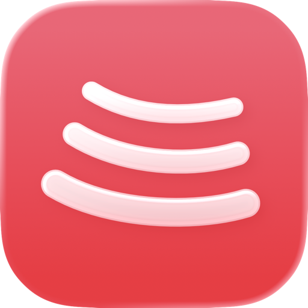
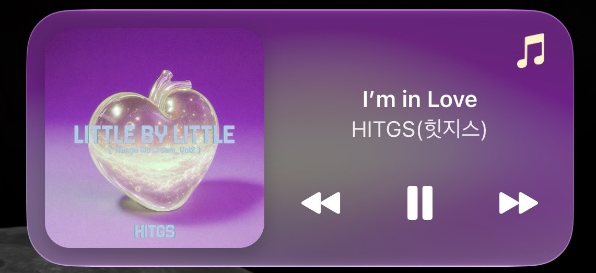

<p align="center">
  
</p>

# BitChord for iOS

iPhone과 iPad에서 사용하는 오픈소스 YouTube Music 클라이언트입니다. 음악 탐색·재생, 동기화 가사, 오프라인 보관, 애드온 음원을 지원하며 한국어와 플레이어 사용자화, 앱 내부 프록시를 더했습니다.

[최신 IPA 다운로드](https://github.com/04pril/BitChord-iOS/releases/latest) · [설치](#설치) · [주요 기능](#주요-기능) · [직접 빌드](#직접-빌드) · [업데이트 내역](https://github.com/04pril/BitChord-iOS/releases)

[BitChord for Android](https://github.com/kushagrasinghx/BitChord)의 [iOS 포트](https://github.com/maanya145/BitChord-iOS)를 기반으로 한 개인 포크입니다. Google·YouTube·Apple의 공식 앱이 아닙니다.

## 주요 기능

### 음악과 음질

- YouTube Music의 추천·검색, 아티스트·앨범·플레이리스트 탐색과 재생.
- Wi-Fi와 모바일 데이터의 스트리밍 음질을 각각 설정.
- 애드온 음원 연결·우선순위 설정과 무손실·Atmos 음원 지원. 실제 제공 음질은 소스와 곡에 따라 다릅니다.
- 크로스페이드, Automix, 음량 정규화, 이퀄라이저와 취침 타이머.
- 재생 캐시와 다음 곡 미리 준비.

### 가사와 플레이어

- 여러 가사 제공자의 동기화 가사, 번역·로마자 표시와 가사 타이밍 조정.
- 가사 크기·굵기를 전체 또는 한글·영문별로 설정하고 미리보기.
- 가사 출처·변경 버튼 표시와 흐림 효과 선택.
- 앨범아트 색상을 반영한 플레이어 배경과 플로팅 앨범아트. 재생·일시정지에 맞춰 커버 크기와 그림자가 변합니다.
- 설정의 Language 메뉴에서 한국어 선택. 일부 화면은 원문으로 표시될 수 있습니다.

### 보관함과 연동

- Google 계정 로그인, 여러 계정·프로필 전환과 YouTube Music 보관함 이용.
- 곡 다운로드와 오프라인 재생, 파일 앱의 음원 가져오기.
- SMB·WebDAV 네트워크 보관함.
- 함께 듣기, Replay 감상 통계, Last.fm·ListenBrainz·Discord 연동.
- 설정과 감상 기록 내보내기·복원.

### 위젯과 연결

- 잠금화면·제어 센터의 재생 조작과 다이나믹 아일랜드 앱 연결 보완.
- 컬러 4×2·2×2와 기본 2×2·4×2·4×1, 총 5개 홈 화면 위젯. 투명·틴트 사용자화에서도 앨범아트를 표시합니다.
- YouTube·YouTube Music 링크를 여는 공유 확장.
- WireGuard 또는 HTTP·HTTPS·SOCKS5를 사용하는 앱 내부 프록시. 로그인 화면에도 적용합니다.



## 설치

**iOS 17 이상**의 iPhone 또는 iPad가 필요합니다.

1. [최신 릴리즈](https://github.com/04pril/BitChord-iOS/releases/latest)에서 `BitChord-<버전>.ipa`를 받습니다.
2. Feather 등 IPA 서명·설치 도구로 설치합니다.
3. **Settings → Language → App language → 한국어**에서 언어를 선택합니다.
4. 프록시가 필요하다면 홈 화면의 **로그인** 옆 **프록시 설정**에서 먼저 설정하고 앱을 완전히 종료한 뒤 다시 엽니다.
5. YouTube Music에 로그인합니다.

기존 앱을 업데이트할 때는 같은 앱 식별자와 서명 접근 그룹을 유지하세요. 변경하면 별도 앱으로 설치되거나 저장된 로그인·프록시 설정에 접근하지 못할 수 있습니다. 홈 화면 위젯은 앱과 확장이 같은 App Group을 사용할 수 있어야 합니다.

## 음원 재생 방식

**설정 → 음원 서비스 → 음원 재생 방식**에서 선택합니다. 선택한 모드 아래에 세부 옵션이 펼쳐집니다.

| 모드 | 재생 방식 | 세부 설정 |
|---|---|---|
| 빠른 재생 | 애드온 조회 없이 YouTube만 사용합니다. | Wi-Fi·모바일 음질 설정 사용 |
| 연속 재생 우선 | 빠르게 시작하고 더 좋은 음원과 다음 곡을 준비합니다. 준비된 애드온 음원이 있으면 처음부터 사용할 수 있습니다. | 재생 중 자동 음원 전환, 기본 켬 |
| 애드온 우선 재생 | 애드온을 우선 기다리고, 없거나 시간이 지나면 YouTube를 사용합니다. | 5·12·15·20초, 기본 12초 |

연속 재생 우선에서 자동 전환을 꺼도 다음 곡 준비는 계속됩니다. 애드온 우선의 대기 시간은 재생 요청부터 계산하며, YouTube로 시작한 뒤 늦게 도착한 음원으로 자동 전환하지 않습니다.

연속 재생 우선과 애드온 우선은 최대 다음 4곡을 준비합니다. 일반 Wi-Fi에서는 바로 다음 곡 전체와 뒤의 곡 앞부분을 준비합니다. **모바일 데이터로 다음 곡 전체 준비**는 기본 꺼짐이며, 필요할 때 각 모드의 펼침 메뉴에서 켤 수 있습니다.

## 자주 쓰는 설정

| 원하는 설정 | 위치 |
|---|---|
| 가사 크기·굵기, 출처·변경 버튼, 흐림 | 화면 및 플레이어 → 가사 폰트 설정 |
| 플로팅 앨범아트 | 화면 및 플레이어 |
| 음원 모드·애드온 관리 | 음원 서비스 |
| 프록시 | 계정 및 연동 → 프록시, 또는 로그인 전 홈 카드 |
| 여러 곡의 로그 기록·공유 | 진단 → 전체 로그 기록 |
| 재생 캐시 삭제 | 진단 → 전체 로그 기록 → 재생 테스트 |
| 홈 위젯 공유 상태 확인 | 진단 → 위젯 연결 |

전체 로그 기록은 기본 꺼짐입니다. 재생 캐시를 지우면 재생을 멈추고 스트리밍 캐시·미리 준비한 재생 항목을 비우며, 다운로드와 가져온 파일은 유지합니다.

## 프록시 사용

본인의 WireGuard `.conf` 또는 외부 프록시 서버 정보를 설정합니다. 연결 방식을 저장한 뒤 앱을 완전히 종료하고 다시 열면 적용됩니다. 개인 프로필·개인키·인증서는 저장소나 IPA에 포함하지 않습니다.

앱 내부 API·HTTP 오디오·다운로드와 Google 로그인 웹 화면에 적용하며, 기기 전체를 연결하는 시스템 VPN은 아닙니다. 프록시를 사용하는 다운로드가 끝날 때까지 앱을 열어 두세요.

설정 형식, 적용 범위와 연결 진단은 **[프록시 안내](docs/PROXY.md)**를 참고하세요.

## 직접 빌드

Mac과 Xcode 27, [WireGuard/go.mod](WireGuard/go.mod)에 지정된 Go 툴체인, 의존성을 받을 수 있는 인터넷 연결이 필요합니다.

```sh
git clone https://github.com/04pril/BitChord-iOS.git
cd BitChord-iOS
scripts/make-ipa.sh
```

한국어 문자열과 프록시 엔진을 준비한 뒤 앱·공유 확장·위젯을 빌드합니다. 결과는 `build/BitChord-<버전>.ipa`입니다.

GitHub Actions의 **[Build IPA](https://github.com/04pril/BitChord-iOS/actions/workflows/build-ipa.yml)**를 실행해 `BitChord-IPA` 아티팩트로 받을 수도 있습니다. 테스트·프로젝트 구성·직접 서명에 관한 자세한 설명은 [원본 개발 안내](docs/UPSTREAM-README.md#building-from-source)를 참고하세요. 이 포크에서 Xcode로 직접 빌드할 때의 엔진 준비 명령은 [프록시 안내](docs/PROXY.md#개발자-참고)에 있습니다.

## 업데이트와 문제 제보

- 버전별 변경 사항과 IPA: [GitHub Releases](https://github.com/04pril/BitChord-iOS/releases)
- 빌드별 구현·진단 기록: [개발 기록](docs/DEVELOPMENT-NOTES.md)
- 기능 대응과 프로젝트 구조: [원본 README](docs/UPSTREAM-README.md), [포팅 문서](docs/PORTING.md)
- 문제 제보: [Issues](https://github.com/04pril/BitChord-iOS/issues)

재생 문제를 제보할 때는 앱 버전, 선택한 재생 모드, 곡 정보와 재현 순서를 함께 적어 주세요. 필요할 때 전체 로그 기록을 켜서 재현한 뒤 파일을 첨부하면 원인 확인에 도움이 됩니다.

## 출처와 라이선스

- iOS 포트: [maanya145/BitChord-iOS](https://github.com/maanya145/BitChord-iOS)
- Android 원 프로젝트: [kushagrasinghx/BitChord](https://github.com/kushagrasinghx/BitChord)
- 앱 내부 프록시 기반: [04pril/ytmu](https://github.com/04pril/ytmu), [kes158/YTMusicUltimate](https://github.com/kes158/YTMusicUltimate)
- [GPL-3.0](LICENSE), [서드파티 고지](THIRD-PARTY-NOTICES.md), [WireGuard 구성 요소 라이선스](WireGuard/THIRD_PARTY_LICENSES.txt)
