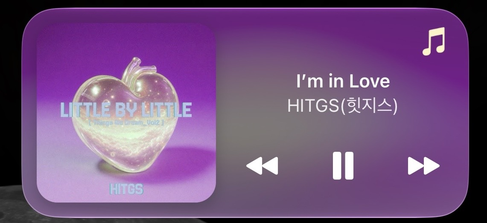

<!-- 릴리즈 설명 관리: 기존 주요 업데이트와 추가 수정 이력은 유지합니다. 새로 배포한 수정은 추가 수정 맨 아래에 날짜·항목을 덧붙이고, 해당 릴리즈 설명에도 반영합니다. 사용자 실기기 확인과 자동 테스트 결과를 구분하며, IPA에 포함되지 않은 변경은 기록하지 않습니다. -->

## 주요 업데이트

**컬러 위젯**

  

- **로그인 전 프록시 설정:** 홈의 로그인 버튼 옆에 **프록시 설정**을 추가하고, 로그인 전 설정·앱 재시작 안내를 표시합니다. 안내 문구와 카드가 화면 밖으로 잘리지 않도록 너비와 줄바꿈을 보완했습니다.
- **로그인 창 프록시 적용:** 앱 내부 Google 로그인 창에도 설정한 WireGuard·HTTP·HTTPS·SOCKS5 프록시를 적용합니다. 설정 실패 시 직접 연결로 우회하지 않고 안내합니다. 연결 설정을 바꾼 뒤에는 앱을 완전히 종료하고 다시 열어 주세요.
- **첫 재생 속도 개선:** YouTube AAC 음원의 초기 데이터를 이어 받아, 곡을 분석하는 동안 다운로드가 반복해서 끊기고 다시 시작되던 대기를 줄였습니다.
- **무손실 전환 안정성 개선:** FLAC 형식 판별과 전환 전 캐시·탐색 준비를 보완했습니다. 곡 넘기기·정지와 음원 전환이 겹칠 때 이전 곡이 계속 재생되거나 조작이 밀리던 문제를 보완했습니다.
- **위젯 연결 보완:** 재서명으로 공유 그룹이 바뀌는 경우에도 앱과 위젯이 같은 저장소를 찾도록 개선하고, 현재 곡·표지·재생 상태 전달 및 위젯 연결 진단을 추가했습니다.
- **설정 위치 정리:** **음원 재생 방식**은 음원 서비스 맨 위에, **재생 캐시 지우기**는 전체 로그 기록 화면에 배치했습니다.
- **재생 모드 3종 추가:** YouTube만 사용하는 **빠른 재생**, 바로 재생하며 더 좋은 음원을 준비하는 **연속 재생 우선**, 애드온 음원을 먼저 기다리는 **애드온 우선 재생**을 선택할 수 있습니다.
- **모드별 세부 설정:** 연속 재생 우선은 자동 음원 전환을 켜고 끌 수 있으며 기본값은 켜짐입니다. 애드온 우선의 대기 시간은 **5·12·15·20초**, 기본 **12초**입니다.
- **다음 곡 미리 준비:** 두 애드온 재생 모드에서 다음 최대 **4곡**을 준비합니다. Wi-Fi에서는 바로 다음 곡 전체를, 나머지는 앞부분만 캐싱합니다. 모바일에서도 전체 준비를 허용하는 옵션을 추가했으며 기본값은 꺼짐입니다.
- **음원 선택·안정성 개선:** 한글·중문 매칭과 다른 가수의 커버가 원곡 대신 선택되던 문제를 수정했습니다. 모드 변경과 음원 준비 작업이 겹칠 때 발생할 수 있는 오류도 보완했습니다.
- **전체 로그·테스트 기능 추가:** 여러 곡의 재생 기록을 모으는 **전체 로그 기록·공유·삭제**를 추가했으며, 기록은 기본 꺼짐입니다. 전체 로그 기록 화면에서 **재생 캐시 지우기**를 사용할 수 있고, 로그에는 선택 모드·자동 전환·대기 시간·음질과 플레이어 준비·출력 경로가 표시됩니다.

---

## 추가 수정

### 2026-11-13 · 다운로드

- **프록시 다운로드 수정:** 프록시 사용 중 음원 다운로드가 HTTP 403으로 실패하던 경로를 보완했으며, 테스트 버전에서 다운로드 성공을 확인했습니다. 다운로드가 끝날 때까지 앱을 열어 두세요.

### 2026-11-14 · 투명·틴트 위젯

- **투명·틴트 위젯 수정:** 홈 화면 사용자화에서 5개 위젯의 앨범아트가 흰색으로 표시되거나 사라지던 문제를 수정했습니다. 테스트 버전에서 실제 표시를 확인했습니다.

### 2026-11-15 · AirPlay

- **AirPlay 재생 수정:** 아이폰에서 MacBook Pro로 AirPlay 연결 후 음악이 재생되지 않던 문제를 수정했으며, 사용자 실기기에서 정상 재생을 확인했습니다.
- **재생 경로 보완:** 캐시·인증·오디오 처리를 아이폰에서 유지하면서 선택한 AirPlay 오디오 경로로 출력합니다. 미디어 서비스 재시작 후에도 같은 설정을 유지합니다.
- **AirPlay 진단 추가:** 로그에 외부 재생 상태와 AVFoundation 세부 오류 코드를 추가했습니다.

기존 앱과 같은 앱 식별자·공유 저장소를 사용합니다. 기존 앱을 삭제하지 않고 같은 서명 설정으로 덮어설치하면 로그인과 설정을 유지할 수 있습니다.
